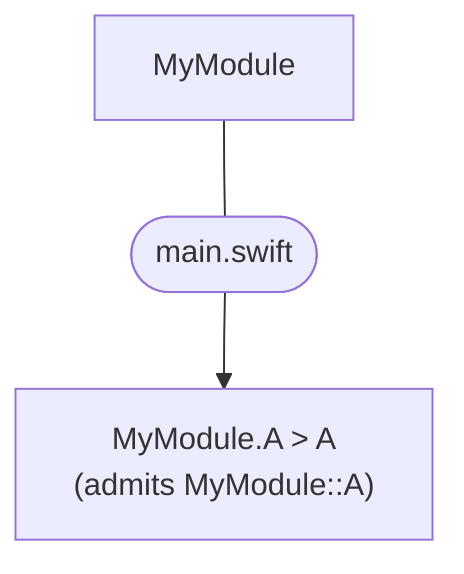
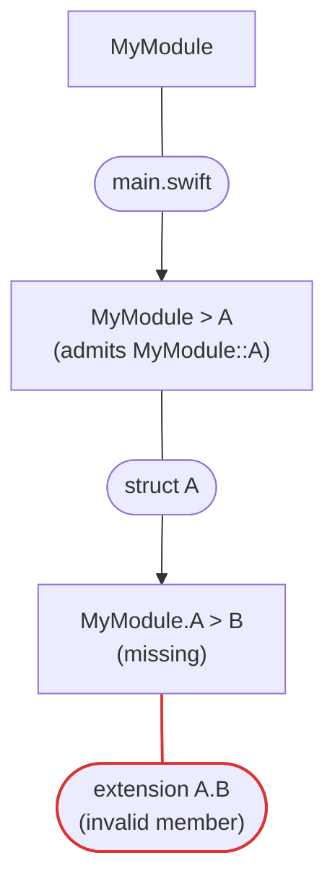
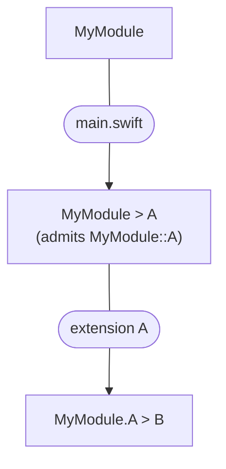
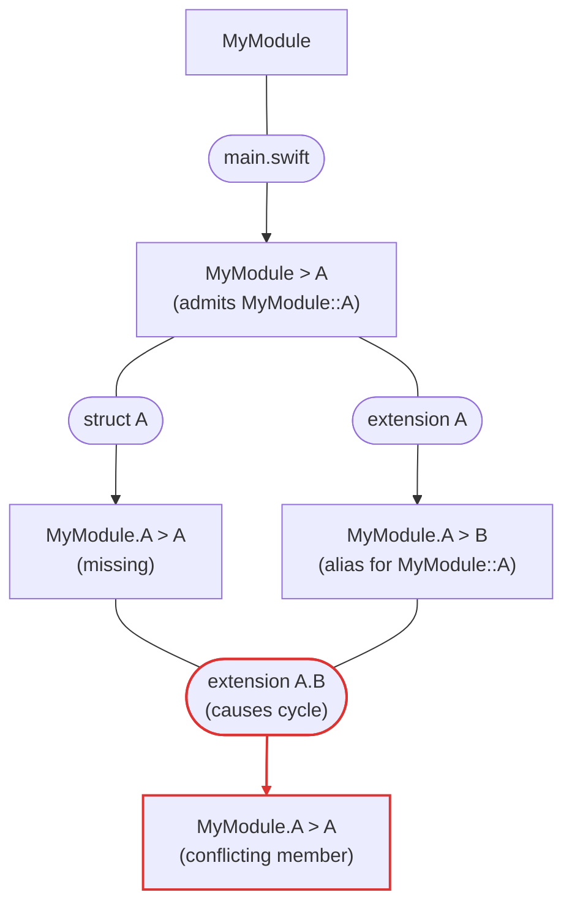
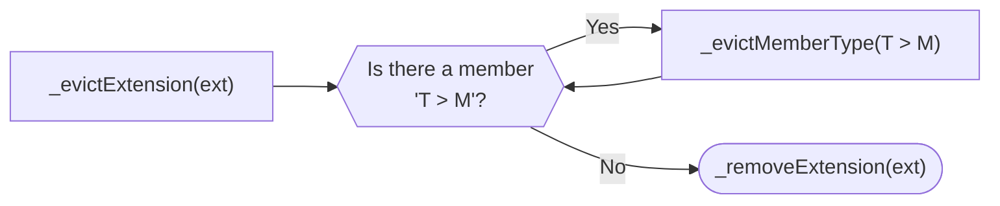
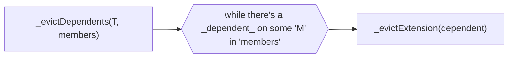
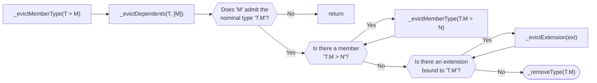
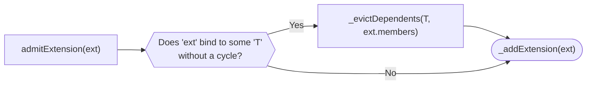

# `TypeGraph`

The `TypeGraph` keeps track of which declaration groups introduce which type members, and which type members each extension depends on. A graph is necessary because of two powerful Swift features:

1. Type aliases make finding extensions a global problem. To resolve “A,” we can’t just find `extension A {}`; we also need, say, `extension AliasedA {}`. Instead, we have to bind all accessible extensions to determine which extensions actually resolve to `A`.
2. We can extend a type declared in an extension, making extension binding incremental. In other words, one-by-one, we must resolve each extension, admit it into a dependency graph, and evict any dependent extensions.

## Design

### Conceptual Graph

Conceptually, `TypeGraph` is a directed acyclic graph where:

- **Nodes are type members**, written `Base > Name` (e.g. `MyModule.A > B`). Top-level types are members of the module (`MyModule > A`). A member may be a nominal type, a type alias, ambiguous (redeclared), or missing (looked up but never declared).
- **Edges are dependencies**, labeled with the declaration group that introduces the target member. A main declaration (`struct A {}`) leads from the member it declares (`MyModule > A`) to each of its own members. An extension leads from the members it looked up to resolve its extended type (its *dependencies*) to each member it introduces.

So, an extension depends on type members, not on types. It fails to bind if a member it looks up has no declarations (e.g. `A > B` doesn't exist) or more than one (redeclaration), and its result changes whenever another declaration group adds or removes that member. Acyclicity means an extension never recursively depends on a member it introduces itself.

### Representation

`TypeGraph` stores this graph compactly, keeping only what `TypeResolver` can't trivially recover:

- **Admitted nominal types** (`namesToTypes: GlobalTypeName → NominalType`)
- **Extension state** (`extensionsToState: extension → ExtensionState`)

Other members (type aliases, redeclarations, missing members) aren't stored as nodes. `TypeResolver` recovers them on demand by looking the name up in the type tables of the base type's main declaration and bound extensions.

### Example

```swift
struct A {}
//     `- Type 'MyModule::A'
extension A.B { struct A {} }
extension A { typealias B = A }
```

In the conceptual graph, member nodes are boxes and each edge passes through a pill naming the declaration group that introduces its target:



Think about how you would determine what `extension A.B` refers to. You'll notice that you can't directly admit all extensions in order; instead, it's an incremental process that requires `TypeGraph`. The following section explains how exactly we admit extensions.

#### Process

At first, our graph sees only `struct A {}`. Starting from `extension A.B {}`, we admit the extension to the graph with a failed type, since `A` currently has no member `B`, and record that this extension depends on the member `A > B`. The debug description now resembles this:

```swift
struct A {}
//     `- Type 'MyModule::A'
extension A.B { struct A {} }
//        |- Resolved type: failed (type 'A' has no member type 'B')
//        `- Depends on type 'A' > member 'B"
extension A { typealias B = A }
```

Equivalently:



Moving on to the second extension, `extension A {}` resolves successfully to `A`, but `extension A.B {}` depends on `A`. To maintain the graph’s invariant, we first evict `extension A.B {}`, and then admit `extension A {}` into the graph.

```swift
struct A {}
//     `- Type 'MyModule::A'
extension A.B { struct A {} }
extension A { typealias B = A }
//        `- Resolved type: 'MyModule::A'
```

Or in graph form:



Finally, when we try to re-admit the evicted `extension A.B {}`, we run into a problem. If we bind `extension A.B {}` to “MyModule::A,” then the extension will depend on `struct A {}`, a type the extension itself introduces. Hence, we diagnose an extension-cycle error, which is more specific than the compiler’s current warning.

```swift
struct A {}
//     `- Type 'MyModule::A'
extension A.B { struct A {} }
//        |- Resolved type: failed (extension depends on itself)
//        `- Depends on type 'A' > member 'B"
extension A { typealias B = A }
//        `- Resolved type: 'MyModule::A'
```

Visually:



> Note: `TypeGraph` stores only part of this: each extension's state, plus the nominal type `MyModule::A` (with the type tables of `struct A` and `extension A`, and `extension A.B` as a dependent on its members `B` and `A`). We find the members `A > B` and `A > A` in those type tables on demand.

## Detailed Design

### Invariants

Our graph is complex, so we need to maintain some core invariants:

1. No readmission
   Every nominal-type declaration is admitted under exactly one name.
1. Bound extensions
   Every admitted extension resolves to a type name iff that type is registered and references the extension as a bound extension.
1. Extensions depend on type members
   Extension dependencies (the set of type members used to resolve its type syntax) must match the type-member state in the graph. In practice, we admit an extension with valid dependencies, and evict it if the dependency type members change. An extension has at most one dependency per base type, which groups every member it looks up on that type.
1. Dependencies and dependents match
   An extension can have a dependency on a type's member iff the type also records the extension as a dependent. Both the extension and type must be admitted.
1. No cycles
   No extension's recursive dependencies should rely on a type member identifier that the extension introduces
1. Registered file roots
  Every admitted top-level nominal type and extension declaration must have its file root registered through `SymbolTable`. Ensures we can find the members' `TypeTable`.
1. Nested types have parents
   If a type is nested under a declaration group, it must be in the declaration group's type table (ensures we can find nested types). If the declaration group is a nominal type declaration, that nominal type must be admitted. If the declaration group is an extension, that extension must be admitted and bound to the parent type.

To maintain these invariants, we carefully gate all mutations through a set of core operations: adding and removing types and extensions.

### Mutation Primitives

Only these operations should mutate the graph. Each core operation assumes the graph is valid, doesn't call other core operations in its body, and leaves the graph in a valid state.

#### Add Type

`_addType` imposes the additional precondition that if the given type "Inner" is nested, it's parent "Outer" (resolved through a nominal type or extension) is admitted and without dependents on the member "Outer" > "Inner". `_addType` simply adds the given type node to the graph.

> Note: We don't care about dependents on "Outer" > "Inner" when adding a type "Outer.Inner", because admitting "Inner" doesn't affect lookup of `Outer > Inner`, keeping dependents valid. Specifically, lookup results only change when `NominalType/boundExtensions` changes, hence why only `_addExtension` and `_removeExtension` check for dependents.

#### Remove Type

`_removeType` imposes the additional precondition that the given type declaration have no bound extensions, or any type members, and it's parent doesn't have dependents on its member. `_removeType` simply removes the given type node from the graph.

#### Add Extension

`_addExtension` imposes the additional precondition that the extension isn't already admitted, its dependencies match the current type members (and don't form a cycle), and, if it resolves to a type, that type is admitted and has no dependents on the members the extension introduces. `_addExtension` stores the extension's state, records it as a dependent of each dependency's base type, and, if resolved, binds it to its type.

#### Remove Extension

`_removeExtension` imposes the additional precondition that the extension is admitted and, if bound, no extension depends on its members and none of its nested nominal types are still admitted. `_removeExtension` removes the extension's state, its dependent entries, and, if bound, its binding.

### Lookup

`findMemberType` looks up the member `Base > Name`. A local base type has no extensions, so we just search its main declaration. For an admitted base type, we collect the type tables of its main declaration and every bound extension, and order them for shadowing: declaration groups in the origin's file first, then the rest of the origin's module, then other modules. Then, we then gather every declaration of `Name` in that order. The result is recorded in the `DependencyTracker`, so repeating a lookup with the same tracker reuses it, and the recorded lookups become the extension's dependencies.

Lookup is slow: it costs `O(E_T)` for the base type `T`, since it visits and buckets every bound extension of `T`, even ones that don't declare `Name`. That's because, for now, we want constant-time access to extensions when admitting and evicting them (`boundExtensions` is a dictionary keyed by extension), which a sorted or indexed structure wouldn't preserve. We could improve this inefficiency in the future.

### Admission & Eviction

The following operations are mutually recursive. Each primitive (drawn rounded below) is called after we've taken all the rights steps to meet the preconditions.

#### Evict Extension

`_evictExtension` removes an extension from the graph. If the extension is bound, it first evicts each member type the extension introduces, which also evicts their dependents and any nested nominal types.



#### Evict Dependents

To remove a declaration group, we need to ensure the members it introduces don't have any lingering dependents, which is where `_evictDependents` comes in. Given a type `T` and a set of members, it evicts every extension that depends on some `T > M` in that set.



#### Evict Member Type

`_evictMemberType` evicts one member `T > M` introduced by a declaration group. It evicts the member's dependents and, if the member declares the admitted nominal type `T.M`, removes `T.M`: first its nested member types and bound extensions, then the type itself.



#### `admitExtension`

`admitExtension` uses the above. If binding the extension to `T` would create a cycle, we admit it unbound instead. Otherwise, its members change the result of any lookup of `T > M` for those members, so we evict `T`'s dependents on them before adding the extension.



The recursion `_evictDependents → _evictExtension → _evictMemberType → _evictDependents` terminates because each `_evictExtension` removes an admitted extension, and the graph is finite.

### Design Rationale

#### Why not derive dependencies from the extended type?

The first [example](#example) demonstrates that we can't derive dependencies from the extended type's name because of type aliases. Namely, `extension A.B` resolves to `MyModule::A` and depends on both `A > B` (the alias) and `A > A`: `typealias B = A` only resolves to the top-level `A` because `A` has no member `A`. Hence, `TypeResolver` records every qualified lookup it performs in a `DependencyTracker`, and the graph stores those exact dependencies.

#### If nodes are member types, why do we store nominal types?

Because only nominal types need a stored identity: resolution must end at a unique nominal type, and nested types need an admitted parent. Every other member (a type alias, a redeclaration, a missing member) is a lookup of a name in the base type's type tables, which `TypeResolver` can redo on demand. Storing those members would cache derived data that every extension admission or eviction would have to invalidate.

#### Why use `NominalTypeDeclSyntax` instead of `TypeSyntax`?

Because `TypeResolver` ultimately cares about resolving to unique nominal types. So, if we had `TypeSyntax` nodes, we'd essentially be caching the resolved type of type aliases. However, the graph is already complicated enough and caching at the graph level wouldn't necessarily improve performance.

#### Why are `namesToTypes` and `extensionsToState` keyed by syntax nodes?

While the conceptual graph has member types as nodes and declaration groups as edges, `SymbolTable` drives `TypeGraph` through `NominalTypeDeclSyntax` and `ExtensionDeclSyntax` syntax nodes. That is, `SymbolTable` will request that a particular nominal type or extension be admitted; it doesn't have knowledge of member types.

#### Why "admit" and not "bind" extensions?

The compiler uses the term "extension binding." However, here, we say that the graph *admits* extensions (whether valid or invalid), and only *binds* them if they successfully resolve and don't cause cycles. Thus, "extension admission" emphasizes that the graph is often in an imperfect state that contains unbound/erroneous extensions.
